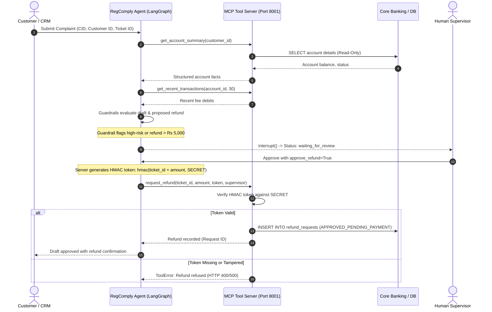

# Core-Banking Integration Guide (B3 MCP Tool Server)

This document specifies how the RegComply Model Context Protocol (MCP) tool server connects the GenAI complaint agent to a bank's core-banking architecture (e.g., Finacle, BaNCS, Flexcube).

---

## 1. Architecture Overview

The integration uses the **Model Context Protocol (MCP) Python SDK v2** (`MCPServer`) to enforce the principle of least privilege:
- **Read-Only Access**: The agent queries account summaries, transaction logs, and ticket statuses over standard MCP tool interfaces. The agent cannot alter data.
- **Cryptographically Gated Write Access**: Financial actions (`request_refund`) cannot be executed by the LLM directly. A write action strictly requires a server-issued HMAC-SHA256 approval token signed by an authorized human supervisor.



---

## 2. Enterprise Integration Dimensions

| Topic | Production Banking Implementation |
|---|---|
| **Swap the Data Layer** | In production, SQLite is replaced with the bank's existing Enterprise Service Bus (ESB) or REST/gRPC core-banking APIs (e.g., Finacle Connect, TCS BaNCS API gateway) or an isolated read-replica database. Crucially, the **MCP tool contracts, names, schemas, and return models stay identical**, shielding the LLM agent from backend changes. |
| **Identity & Access Management (IAM)** | The MCP tool server runs under a dedicated service identity. Read-only tools use an IAM service account with `SELECT`-only privileges on designated views (never direct customer PII). The write pathway uses a separate, strictly partitioned payment service account. |
| **Network & Perimeter Security** | The MCP server resides strictly within the bank's private Virtual Private Cloud (VPC) / Demilitarized Zone (DMZ). It communicates over Mutual TLS (mTLS) with IP allowlisting; only authenticated instances of the RegComply Agent service can reach port 8001. |
| **Audit & Non-Repudiation** | Every tool invocation logs `(timestamp, actor, tool_name, input_params, execution_ms, status)` directly to an immutable enterprise audit store (e.g., Splunk, Elasticsearch, Azure Monitor) for RBI compliance audits. |
| **Cryptographic Approvals** | Prototyped using HMAC-SHA256 tokens (`APPROVAL_SECRET`). In an enterprise deployment, this integrates with the bank's Dual-Control / Four-Eyes authorization workflow: refunds exceeding threshold tiers (e.g., > Rs 25,000) require two independent cryptographic sign-offs before execution. |
| **Testing & CI/CD Verification** | The automated regression test suite (`tests/test_mcp.py`) runs in the deployment pipeline against a staging environment before each production rollout, validating tool contracts, edge cases, error resilience, and idempotency. |

---

## 3. Tool Specifications & Schemas

### 1. `get_account_summary`
- **Purpose**: Fetches account classification, active/dormant status, and current balance.
- **Privacy Guarantee**: Returns **zero** customer PII (no customer name, phone number, physical address, or PAN).
- **Parameters**: `customer_id: str`
- **Returns**: `{"account_id": str, "type": str, "status": str, "balance_inr": float}`

### 2. `get_recent_transactions`
- **Purpose**: Retrieves recent account debits/credits for fee dispute reconciliation.
- **Constraints**: Default 30 days, maximum lookback 90 days (enforced by server).
- **Parameters**: `account_id: str`, `days: int = 30`
- **Returns**: `list[{"txn_id": str, "txn_date": str, "description": str, "amount_inr": float, "channel": str}]`

### 3. `get_ticket`
- **Purpose**: Queries grievance tracking status and assigned department from the CRM.
- **Parameters**: `ticket_id: str`
- **Returns**: `{"ticket_id": str, "customer_id": str, "opened": str, "category": str, "status": str, "assigned_team": str}`

### 4. `request_refund` (Gated Write Action)
- **Purpose**: Stages a financial refund for credit processing.
- **Idempotency**: Strictly idempotent (`UNIQUE(ticket_id, amount_inr)`). Duplicate calls return the existing record with `note: "already recorded"`.
- **Authorization**:
  ```python
  token = hmac.new(APPROVAL_SECRET.encode(), f"{ticket_id}:{amount_inr:.2f}".encode(), hashlib.sha256).hexdigest()[:20]
  ```
- **Parameters**:
  - `ticket_id: str`
  - `amount_inr: float` (Range: ₹1.00 – ₹100,000.00)
  - `reason: str`
  - `approval_token_value: str` (HMAC signature)
  - `approved_by: str` (Named supervisor ID)
- **Returns**: `{"request_id": str, "ticket_id": str, "amount_inr": float, "status": "APPROVED_PENDING_PAYMENT", "approved_by": str}`
