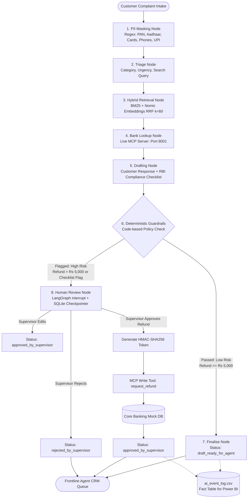

# RegComply Agent: GenAI Banking Regulatory Compliance & Complaint Automation

[](https://www.python.org/downloads/)
[](https://github.com/langchain-ai/langgraph)
[](https://modelcontextprotocol.io/)
[-brightgreen.svg)](#financial-modeling--cost)
[](#how-to-run)

> **Category B Flagship Portfolio Project** for GenAI Solutions Consultant Roles at Big 4 Firms (EY GDS, Deloitte USI, PwC AC, KPMG).  
> **Author**: Aryan Patel, MBA (Business Analytics) | Senior GenAI Engineer & Solutions Consultant.

---

## 1. Problem & Executive Results

Indian commercial banks handle over 23,000 monthly grievances where every customer reply must strictly adhere to binding **Reserve Bank of India (RBI)** master circulars regarding unauthorized transactions, fee reversals, and turnaround times. The **RegComply Agent** is a privacy-first, human-in-the-loop autonomous system that classifies complaints, retrieves governing RBI circular clauses, queries core-banking facts via the **Model Context Protocol (MCP)**, checks deterministic code guardrails, and drafts compliant responses with citations.

### Key Benchmark Performance (Evaluated on 100 Verified Questions)
* **Section-Aware Chunking Lift**: Raised `Hit@5` from **67.9% to 80.4%** (**+12.5 percentage points**) over naive fixed chunking.
* **Multi-Clause Recall**: Hybrid search (BM25 + Dense RRF fusion) achieved **79.5% recall** across multi-section grievances.
* **Zero Regulatory Hallucination**: **92.9%** of cited sections matched retrieved chunks; zero invented circular clauses.
* **LLM Judge Concordance**: Blind human audit across 20 model-judged answers demonstrated **95% agreement**.
* **Financial ROI**: Unit cost is **$0.00** locally and modeled at **₹0.33 ($0.0039) per complaint** on enterprise cloud APIs, slashing tier-1 triage costs by **86.6%** (generating ₹17.5 lakh in recurring monthly savings for mid-size banks).

| Evaluation Run | Strategy | Retriever | $k$ | Hit@$k$ | Recall@$k$ | MRR | Citations Valid | Cost / Query |
|---|---|---|---|---|---|---|---|---|
| `fixed300_bm25` | Naive Fixed (300 words) | BM25 | 5 | 0.679 | 0.661 | 0.535 | — | $0.00 |
| `section150_bm25` | Small Section (150 words) | BM25 | 5 | 0.786 | 0.777 | 0.652 | — | $0.00 |
| `section300_bm25` | Section-Aware (300 words) | BM25 | 5 | 0.804 | 0.786 | 0.662 | — | $0.00 |
| `section300_dense` | Section-Aware (300 words) | Dense | 5 | 0.786 | 0.768 | 0.585 | — | $0.00 |
| **`section300_hybrid`** | **Section-Aware (300 words)** | **Hybrid** | **5** | **0.804** | **0.795** | **0.647** | — | **$0.00** |
| **`section300_hybrid_full` (Dev 70)** | **Section-Aware (300 words)** | **Hybrid** | **5** | **0.804** | **0.795** | **0.647** | **0.929** | **$0.0039** |
| **`test30_hybrid_full` (Held-Out 30)** | **Section-Aware (300 words)** | **Hybrid** | **5** | **0.875** | **0.833** | **0.753** | **0.933** | **$0.0037** |

---

## 2. System Architecture

The agent is built on a non-negotiable **"Humans in Control"** architecture: no response or financial refund is ever dispatched to a customer autonomously.



---

## 3. Core Architectural & Design Decisions

1. **Why LangGraph over CrewAI / AutoGen?**  
   Regulated banking workflows require a deterministic, auditable execution path with persistent state serialization and explicit pause-and-resume semantics. LangGraph provides typed schemas, directed acyclic graphs, and SQLite checkpointers (`SqliteSaver`). CrewAI and AutoGen favor open-ended multi-agent role-playing, which introduces unacceptable stochastic latency and nondeterministic routing in financial compliance.
2. **Why Section-Aware Chunking over Naive Splitting?**  
   Legal and regulatory texts lose all meaning when chopped arbitrarily mid-clause. By parsing numbered regulatory sections (`SECTION_RX`) and prefixing each chunk with circular metadata, we raised `Hit@5` by **+12.5 percentage points** and prevented context fragmentation.
3. **Why Hybrid Search (BM25 + Dense RRF)?**  
   Dense vector embeddings alone often rank general explanations above specific statutory thresholds ($T+5$, ₹500/day). BM25 guarantees keyword precision on regulatory numbers, while dense retrieval captures paraphrased customer sentiment. Reciprocal Rank Fusion ($k=60$) combines both signals without arbitrary score weighting.
4. **Why Model Context Protocol (MCP Python SDK v2)?**  
   Decouples prompt reasoning from core-banking database schemas. The agent queries standard MCP tools (`get_account_summary`, `get_recent_transactions`). If the bank migrates from SQLite to Finacle or BaNCS, only the MCP driver changes; the AI agent remains untouched.
5. **Why Guardrails in Code Rather Than Prompting?**  
   Prompt-based constraints frequently hallucinate compliance under adversarial pressure. We wrote deterministic evaluation logic in pure Python (`check_node`): checking citation validity, enforcing a ₹5,000 refund limit, and verifying that all checklist items are met.

---

## 4. How to Run & Verify

### Step 1: Environment Setup
Ensure Python 3.11 is installed, then set up the virtual environment:
```powershell
# Clone the repository
git clone https://github.com/aryanpatel-creations/regcomply-agent.git
cd regcomply-agent

# Create virtual environment and install pinned dependencies
python -m venv .venv
.venv\Scripts\Activate.ps1
pip install -r requirements.txt
```

### Step 2: Configure Environment (.env)
Create `.env` (or copy from `.env.example`):
```ini
LLM_PROVIDER=ollama
CHAT_MODEL=llama3.2:3b
EMBED_MODEL=nomic-embed-text
OLLAMA_URL=http://localhost:11434
RETRIEVER=hybrid
MCP_URL=http://localhost:8001/mcp
APPROVAL_SECRET=your-secure-256-bit-token-here
```

### Step 3: Run Full Test Suite
Validate the entire 75-test regression suite:
```powershell
pytest -v
# Output: 75 passed in ~3-5 minutes
```

### Step 4: Run Services Locally
Open two terminal windows:
```powershell
# Terminal 1: Launch MCP Core-Banking Tool Server (Port 8001)
.venv\Scripts\python.exe b3_mcp_server.py

# Terminal 2: Launch FastAPI Web Service & Swagger UI (Port 8000)
.venv\Scripts\uvicorn.exe api:app --port 8000 --reload
```
Open **`http://localhost:8000/docs`** to interact with the live Swagger UI.

### Step 5: Docker Containerization
```powershell
docker compose up --build
```

### Option B: 1-Click Cloud Execution (GitHub Codespaces)
Anyone can launch and test the agent entirely in their browser without installing anything locally:
1. Click **`Code` $\rightarrow$ `Codespaces` $\rightarrow$ `Create codespace on main`**.
2. Dependencies install automatically via `.devcontainer/devcontainer.json`.
3. In the Codespaces terminal, run:
   ```bash
   python3 -m uvicorn api:app --host 0.0.0.0 --port 8000
   ```
4. A browser popup will open automatically and redirect straight to the interactive **Swagger UI**!

---

## 5. Artifact Directory & Deliverables

| Deliverable | File / Path | Purpose |
|---|---|---|
| **Clean Data Pipeline (B1)** | [`b1_clean_complaints.py`](file:///c:/Users/aryan/Desktop/project%202%20genai/b1_clean_complaints.py) | PII masking & complaint cleaning with quality reports. |
| **Data Quality Report (B1)** | [`data/clean/quality_report.csv`](file:///c:/Users/aryan/Desktop/project%202%20genai/data/clean/quality_report.csv) | Pre/post cleaning comparison across 23,046 complaints. |
| **Section Parser & Chunks (B1)** | [`b1_parse_chunk.py`](file:///c:/Users/aryan/Desktop/project%202%20genai/b1_parse_chunk.py) | 488 section-based chunks in [`chunks.jsonl`](file:///c:/Users/aryan/Desktop/project%202%20genai/data/clean/chunks.jsonl). |
| **100-Question Golden Set (B2)** | [`eval/golden.jsonl`](file:///c:/Users/aryan/Desktop/project%202%20genai/eval/golden.jsonl) | 80 in-scope + 20 out-of-scope questions with exact quotes. |
| **Evaluation Harness (B2)** | [`b2_eval.py`](file:///c:/Users/aryan/Desktop/project%202%20genai/b2_eval.py) | Automated RAG benchmark with checkpointing. |
| **LLM Judge Audit (B2)** | [`eval/judge_check.csv`](file:///c:/Users/aryan/Desktop/project%202%20genai/eval/judge_check.csv) | 20-sample human-in-the-loop audit (95% agreement). |
| **Evaluation Report (B2)** | [`docs/evaluation_report.md`](file:///c:/Users/aryan/Desktop/project%202%20genai/docs/evaluation_report.md) | Comprehensive executive benchmarking analysis. |
| **MCP Banking Server (B3)** | [`b3_mcp_server.py`](file:///c:/Users/aryan/Desktop/project%202%20genai/b3_mcp_server.py) | FastMCP SDK v2 server with HMAC refund tokens. |
| **Integration Guide (B3)** | [`INTEGRATION.md`](file:///c:/Users/aryan/Desktop/project%202%20genai/INTEGRATION.md) | Core-banking integration guide (Finacle, BaNCS). |
| **LangGraph Agent (Flagship B)** | [`agent/graph.py`](file:///c:/Users/aryan/Desktop/project%202%20genai/agent/graph.py) | Checkpointed state graph with pause-and-resume. |
| **FastAPI Microservice (Flagship B)**| [`api.py`](file:///c:/Users/aryan/Desktop/project%202%20genai/api.py) | REST API exposing `/complaints` and `/reviews`. |
| **Power BI Event Mapping** | [`docs/a3_mapping.md`](file:///c:/Users/aryan/Desktop/project%202%20genai/docs/a3_mapping.md) | Maps `ai_event_log.csv` to Category A executive dashboard. |
| **3-Minute Demo Script** | [`docs/demo_script.md`](file:///c:/Users/aryan/Desktop/project%202%20genai/docs/demo_script.md) | Word-for-word timed video storyboard for portfolio. |
| **Master Interview Prep** | [`docs/interview_answers.md`](file:///c:/Users/aryan/Desktop/project%202%20genai/docs/interview_answers.md) | Big 4 GenAI Solutions Consultant interview Q&A. |
| **Traceability Matrix** | [`docs/traceability.md`](file:///c:/Users/aryan/Desktop/project%202%20genai/docs/traceability.md) | Maps every specification requirement to code. |

---

## 6. Project Limitations & Production Roadmap

* **Regulatory Corpus**: Evaluated on 5 foundational RBI Master Directions. Production roadmap includes expanding vector indexing to Foreign Exchange Management Act (FEMA) circulars and internal banking Standard Operating Procedures (SOPs).
* **Open-Weight Compute**: Benchmarked on local 3.2B parameter models on consumer hardware. Enterprise deployment targets managed Azure Container Apps with vLLM acceleration or Microsoft Foundry private endpoints.
* **Dual-Control Maker-Checker**: For corporate enterprise risk, refund approvals exceeding ₹25,000 will enforce dual-control authorization (requiring two independent supervisor tokens).
