# Category A3 Dashboard Integration & Event Log Schema Mapping

This document specifies how the telemetry generated by the **Category B RegComply Agent** (`data/ai_event_log.csv`) connects directly into the **Category A Transformation Blueprint** Power BI dashboard.

---

## 1. Context & Business Purpose

In Category A, we designed an executive AI Transformation Blueprint for Kestrel Bank, scoping operational complaint triage and projecting operational savings. In Category B, we built the working prototype. 

`data/ai_event_log.csv` serves as the empirical **Fact Table** connecting the engineering build directly to the executive dashboard, providing live audit telemetry to the Chief Operating Officer (COO), Chief Risk Officer (CRO), and Chief Financial Officer (CFO).

---

## 2. Power BI Schema Relationship Diagram

```mermaid
erDiagram
    DIM_COMPLAINTS ||--o{ FACT_AI_EVENTS : "complaint_id"
    DIM_CHANNELS ||--o{ FACT_AI_EVENTS : "channel"
    DIM_REGULATIONS ||--o{ FACT_AI_EVENTS : "citation_id"

    FACT_AI_EVENTS {
        string event_id PK
        datetime timestamp
        string complaint_id FK
        string use_case
        string model
        int input_tokens
        int output_tokens
        float cost_usd
        float cost_usd_if_paid
        int latency_ms
        string guardrail_flag
        string escalated_to_human
        string status
        string agent_outcome
    }
```



---

## 3. Data Dictionary & Field Mapping

| Category B Field (`ai_event_log.csv`) | Data Type | Power BI Target Metric / Dimension | Executive Audience & Strategic Value |
|---|---|---|---|
| `event_id` | Text (UUID) | Fact Event Key | Primary key for distinct complaint processing events. Ensures complete audit traceability. |
| `timestamp` | ISO-8601 DateTime | `DimDate` / Time Dimension | Tracks hourly intake velocity, peak triage volume, and time-of-day SLA compliance. |
| `complaint_id` | Text | `DimComplaints[complaint_id]` | Foreign key joining Category B execution events back to Category A customer records and CRM ticket IDs. |
| `use_case` | Text | Triage Classification | Confirms operational workload category (e.g., *"Complaint draft"*, *"Fraud dispute"*). |
| `model` | Text | Infrastructure Dimension | Flags compute tier (`llama3.2:3b` on Ollama, `claude-3-5-sonnet` on enterprise cloud). |
| `input_tokens` | Integer | Volume Measure | Average prompt + context tokens consumed per query (tracked at ~1,450 tokens). |
| `output_tokens` | Integer | Volume Measure | Draft response + compliance checklist generation size (tracked at ~260 tokens). |
| `cost_usd` | Decimal | Prototype Operating Cost | Represents direct compute expenditure ($0.00 on local open-weight hardware). |
| `cost_usd_if_paid` | Decimal | **CFO Executive Page**: Unit Cost | Modeled enterprise cloud expenditure based on list prices ($0.0039 per complaint). |
| `latency_ms` | Integer | **COO Operations Page**: SLA | Turnaround time per complaint. Visualizes time saved vs 15-minute manual triage. |
| `guardrail_flag` | Text | **CRO Risk Page**: Defect Taxonomy | Categorizes why complaints were escalated (e.g., *"Refund above limit"*, *"Sensitive category"*, *"No flag"*). |
| `escalated_to_human` | Text (Yes/No) | Automation Rate Metric | Core executive KPI: `Automation % = COUNT(escalated_to_human="No") / TOTAL_COUNT`. |
| `status` | Text | Final Disposition State | Operational status (`draft_ready_for_agent`, `waiting_for_review`, `approved_by_supervisor`). |
| `agent_outcome` | Text | Frontline Resolution Feedback | Closed-loop CRM outcome tracking customer satisfaction and agent edits. |

---

## 4. Key Power BI DAX Measures

To display live metrics in the Category A Power BI report, create the following DAX measures:

### 1. Straight-Through Processing (STP) Rate
```dax
STP_Rate = 
DIVIDE(
    CALCULATE(COUNT(FACT_AI_EVENTS[event_id]), FACT_AI_EVENTS[escalated_to_human] = "No"),
    COUNT(FACT_AI_EVENTS[event_id]),
    0
)
```

### 2. Projected Monthly Cost (Enterprise Cloud)
```dax
Projected_Monthly_Cloud_Cost = 
SUM(FACT_AI_EVENTS[cost_usd_if_paid]) * 
DIVIDE(23046, COUNT(FACT_AI_EVENTS[event_id]), 1)
```

### 3. Net Human Labor Hours Saved
```dax
Labor_Hours_Saved = 
VAR TotalComplaints = COUNT(FACT_AI_EVENTS[event_id])
VAR HumanTimeWithoutAI_Hours = TotalComplaints * (15 / 60)
VAR HumanReviewTimeWithAI_Hours = CALCULATE(
    COUNT(FACT_AI_EVENTS[event_id]), 
    FACT_AI_EVENTS[escalated_to_human] = "Yes"
) * (2 / 60)
RETURN
HumanTimeWithoutAI_Hours - HumanReviewTimeWithAI_Hours
```

---

## 5. Implementation Steps in Power BI Desktop
1. Open the Category A Power BI Template (`.pbix`).
2. Click **Get Data** $\rightarrow$ **Text/CSV** $\rightarrow$ Select `data/ai_event_log.csv`.
3. Set column data types: `input_tokens` (Whole Number), `latency_ms` (Whole Number), `cost_usd_if_paid` (Decimal Number), `timestamp` (Date/Time).
4. In Model View, create a 1-to-many relationship from `DimComplaints[complaint_id]` to `FACT_AI_EVENTS[complaint_id]`.
5. Add the DAX measures above to your KPI summary ribbon.
